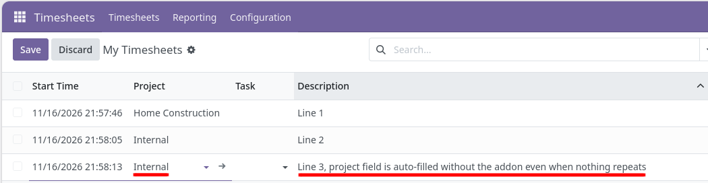
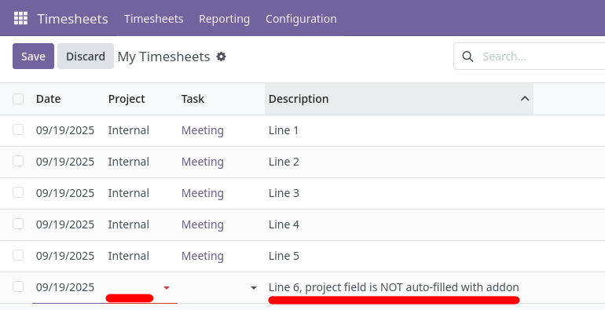
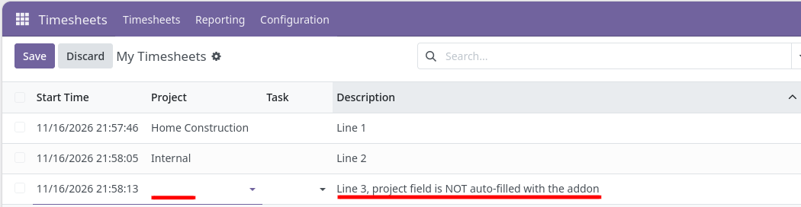

The feature provided by this module is enabled automatically after installation, with no further steps required.

By default, when adding a new line in a timesheet, the system will always autofill the Project field: with the project used most often in the employee's five latest entries (the most recent one in case of a tie, so the last project used when none is repeated), or with the company's internal project if there are no entries yet, as shown below:

With this module installed, this behaviour is disabled and the Project field must be selected manually each time, regardless of previous selections, as shown below:

